# chibi-doro

Head of a chibi Doro (from *NIKKE*) for a custom animatronic figurine. The original head,
`headGK.stl`, has a square socket underneath for a neck peg. `headGK_boss.stl` replaces that
socket with a cylindrical boss so the head can mount on the animatronic's neck. The spec is in
[`instructions_prompt.md`](instructions_prompt.md).

| Before: square socket | After: cylindrical boss |
| :---: | :---: |
| 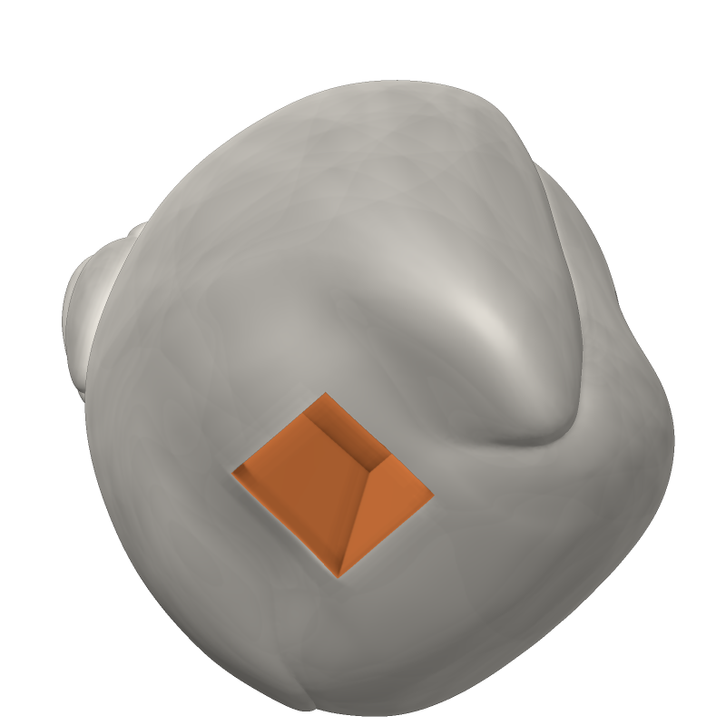 | 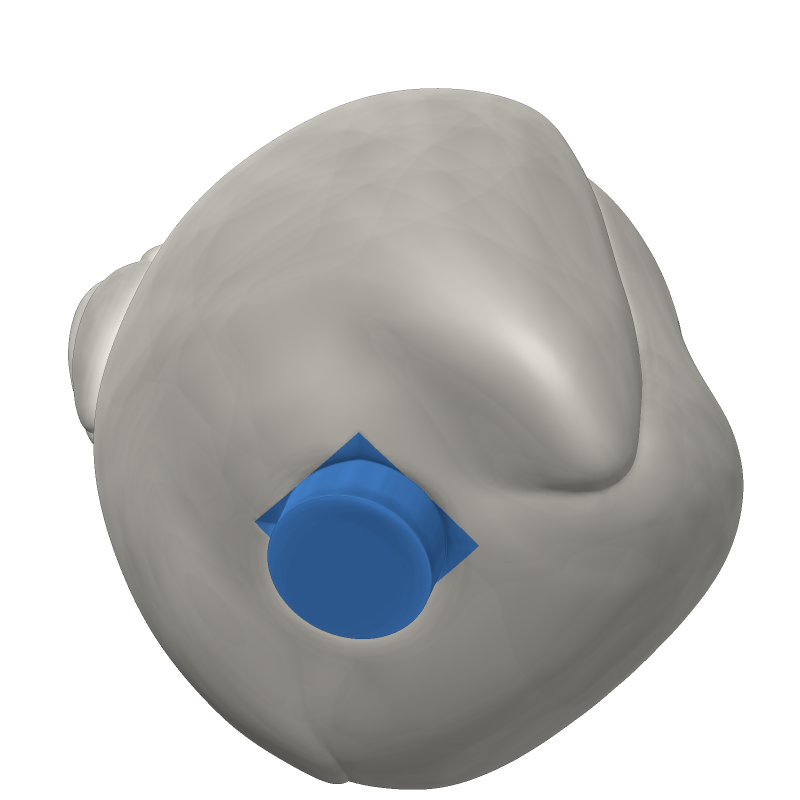 |

In the renders, orange is the socket that was removed and blue is the geometry that replaced it.

## Files

| Path | Contents |
| --- | --- |
| `headGK.stl` | Original head with the square socket, unmodified |
| `headGK_boss.stl` | Head with the socket replaced by the boss |
| `instructions_prompt.md` | The modification spec |
| `scripts/make_boss.py` | Builds `headGK_boss.stl` from `headGK.stl` and checks the result |
| `scripts/render.py` | Regenerates the images in `renders/` |
| `renders/` | Front, back, left, right, top, bottom and three-quarter views of both heads, close-ups of the socket and the boss, and the boss head resting on a table |

Both STLs are binary and share one coordinate frame: the face points −Y, +Z is up, and +X is the
character's left (the side with the rose). STL files carry no units; the measurements below
assume millimetres.

## The boss

As the spec asks, the boss is sized as a percentage of the head, so it scales with the figure.

| Spec | Result |
| --- | --- |
| Axis aligned with the socket's centroid axis | Through the centre of the socket floor, along the floor's normal. It is tilted 18.75° from straight down (−Z) toward the back of the head (+Y). |
| Datum plane through 3 of the socket's corner vertices | The front-left, front-right and back-left corners of the socket opening. The fourth (back-right) corner is 0.055 mm inside this plane. |
| Diameter: 25% of the bounding-box width | 25% of 36.540 = **9.135 mm** |
| Height: the head rests on the boss with nothing else touching the table, and the height is no more than 12% of the head's height in that orientation | Along the boss axis the head is 28.492 mm tall, so the limit is 3.419 mm. The boss uses that limit: **3.419 mm** from the datum plane. The head clears at anything over 0.420 mm, so resting on the boss leaves **3.0 mm** under the rest of the head. |
| No other changes to the head | 299,824 of the 299,998 original triangles are unchanged, bit for bit. The 174 replaced are the socket's walls and floor (132) and the rim triangles the boss cuts through (42). |
| Watertight, with no hanging vertices, edges or faces | Passes every check listed under [Checks](#checks) |

| Socket (before) | Boss (after) |
| :---: | :---: |
| 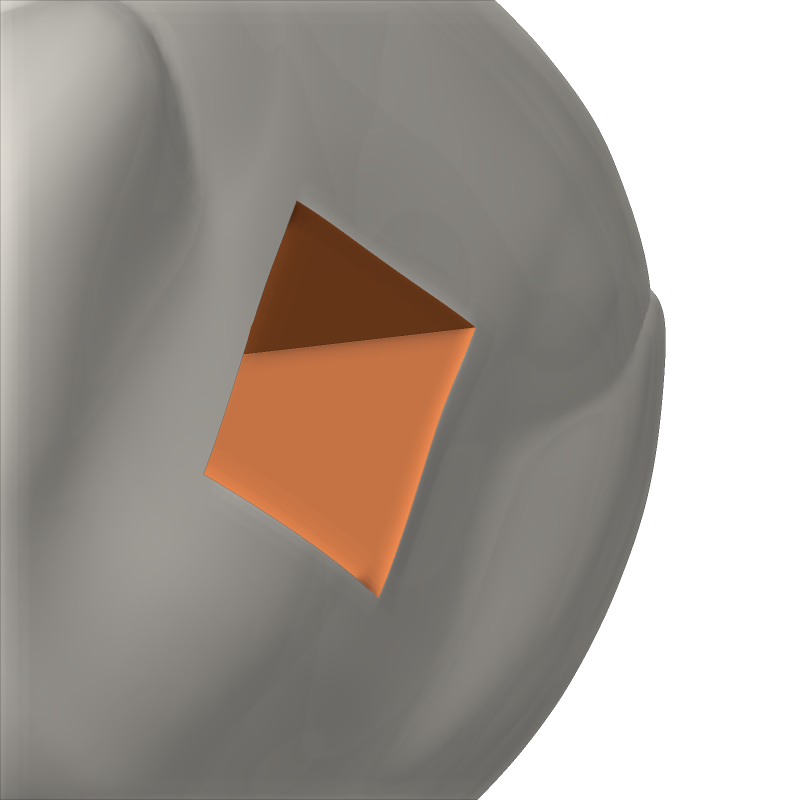 | 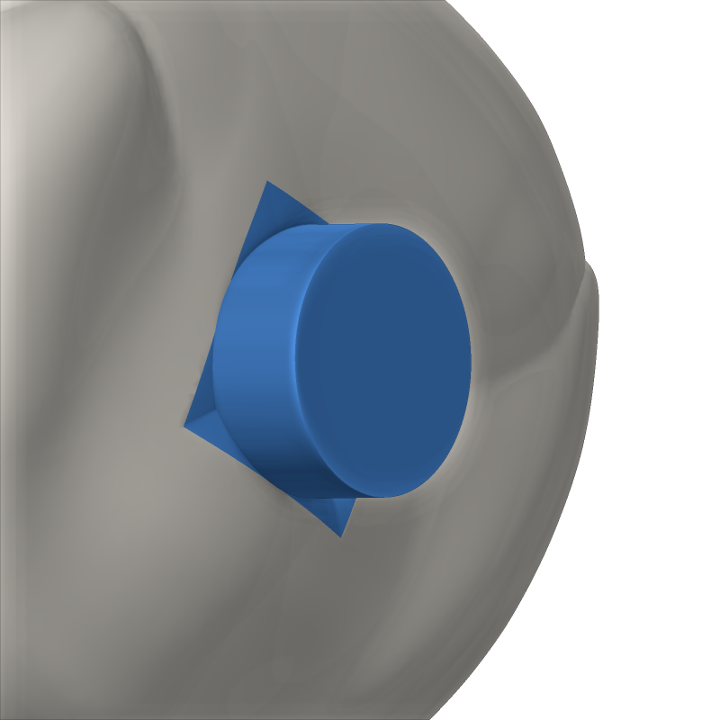 |

| Resting on the boss, side view | Resting on the boss, front view |
| :---: | :---: |
| 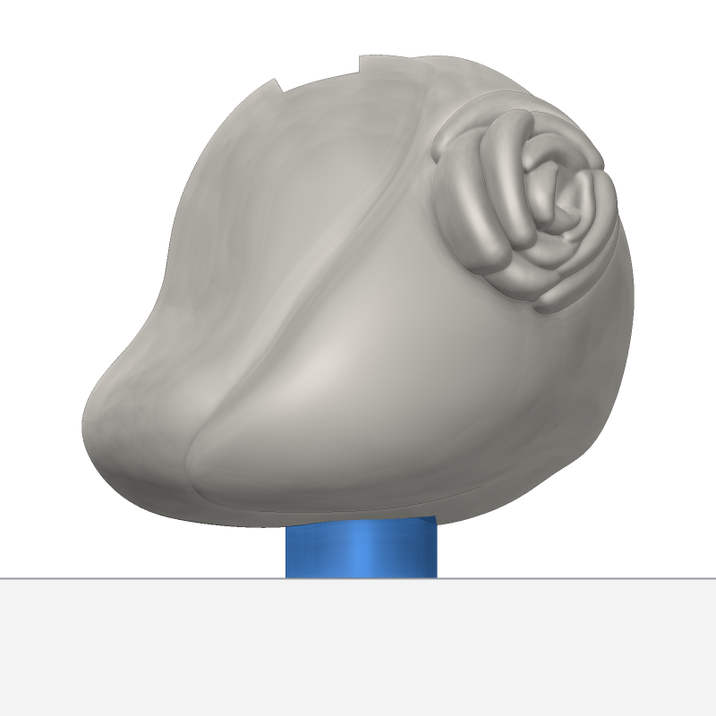 | 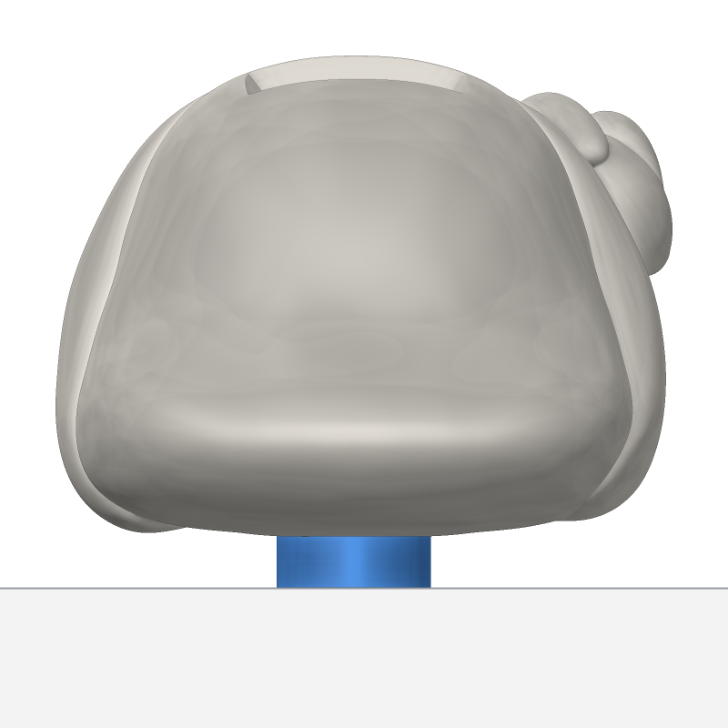 |

### How it is built

`scripts/make_boss.py` does the following:

1. Finds the socket, which is a flat floor and four flat walls (132 triangles). The floor is a
   5.90 mm square and the opening is about 9 mm square. The socket is 7.9 mm deep along its axis,
   with 11° of draft on each wall.
2. Deletes those triangles. It closes the opening with a cap that fans out from the boss axis to the
   original rim. The corners of the old square that the round boss doesn't cover stay flush with the
   surrounding surface.
3. Unions a 128-sided cylinder with the head using
   [manifold3d](https://github.com/elalish/manifold). The cylinder starts 2 mm inside the head, so
   its base is hidden. It ends 3.419 mm beyond the datum plane, with its end face square to the axis.
4. Puts back 2 original triangles on the side of the head. manifold3d re-meshes them when it loads
   the head, because one of them is a sliver almost zero wide. Putting them back keeps the rest of
   the head bit-for-bit original.
5. Reloads the written STL and runs the checks below.

### Checks

These are run on `headGK_boss.stl` as written to disk:

- It is watertight: every edge is shared by exactly two triangles.
- Winding is consistent, normals point outward, and the mesh is one body.
- Topology is unchanged: the Euler characteristic is 0 before and after.
- There are no degenerate or duplicate triangles, no unreferenced vertices and no non-manifold vertices.
- Every original triangle outside the socket and more than 0.5 mm from the boss is still there, bit for bit.
- The boss end face measures Ø 9.135 mm and sits 3.419 mm from the datum plane.
- Resting on the boss leaves 3.0 mm of clearance under the rest of the head.
- The centre of mass is 0.86 mm from the boss axis, well inside its 4.57 mm radius, so the head
  stands without tipping.

## Judgement calls

The spec leaves a few things open. Each of these can be changed in `scripts/make_boss.py`.

- **Axis versus datum plane.** The socket's own axis and the datum plane's normal are 4.1° apart.
  The spec says the boss axis aligns with the socket's axis, so it does. The height is measured
  from where the axis crosses the datum plane.
- **Which three corners.** The four opening corners are within 0.06 mm of one plane, so any three
  give nearly the same datum. The script uses the three whose plane is closest to square with the axis.
- **Height.** Anything from 0.42 mm (just clears) up to the 12% limit (3.419 mm) meets the spec.
  The boss uses the limit, which gives the neck joint the most to grip. `--height-pct` changes it.
- **Width** is the X extent, ear to ear. The boss axis lies in the YZ plane, so the width is the
  same whether the head sits as modelled or on its boss.
- **Head height** is measured along the boss axis and doesn't include the boss.
- **Resting pose.** Standing on its boss, the head tilts face-up by about 19°, because the original
  socket leans toward the back of the head. A vertical neck gives the same tilt.

## Notes on the original model

- The original has 299,998 triangles and a bounding box of 36.54 × 30.12 × 31.95 mm (X × Y × Z).
  It is one closed solid of 18,175 mm³. The boss version has 300,964 triangles and 18,845 mm³.
- There is a rectangular slot at the top front of the head. It is part of the original and is unchanged.
- The mesh has one tiny through-hole (genus 1) at the rose ornament, around (14.8, 5.6, −8.3).
  It comes from the original, and the boss version keeps it.

## Regenerating

Tested with Python 3.10, numpy 1.26, scipy 1.15, trimesh 5.2, manifold3d 3.5 and Pillow 11.

```sh
pip install numpy scipy trimesh manifold3d pillow
python scripts/make_boss.py   # writes headGK_boss.stl, prints the measurements and checks
python scripts/render.py      # rewrites renders/ (takes about 4 minutes)
```

`make_boss.py` also takes `--input`, `--output`, `--diameter-pct`, `--height-pct` and
`--report <file.json>`. It exits with an error if any check fails.

<details>
<summary>All views</summary>

| View | Original | Boss |
| --- | :---: | :---: |
| Front | 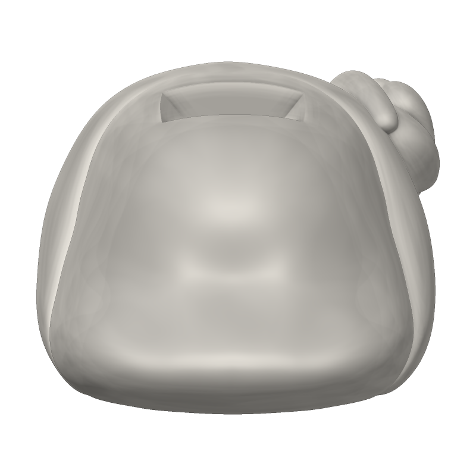 | 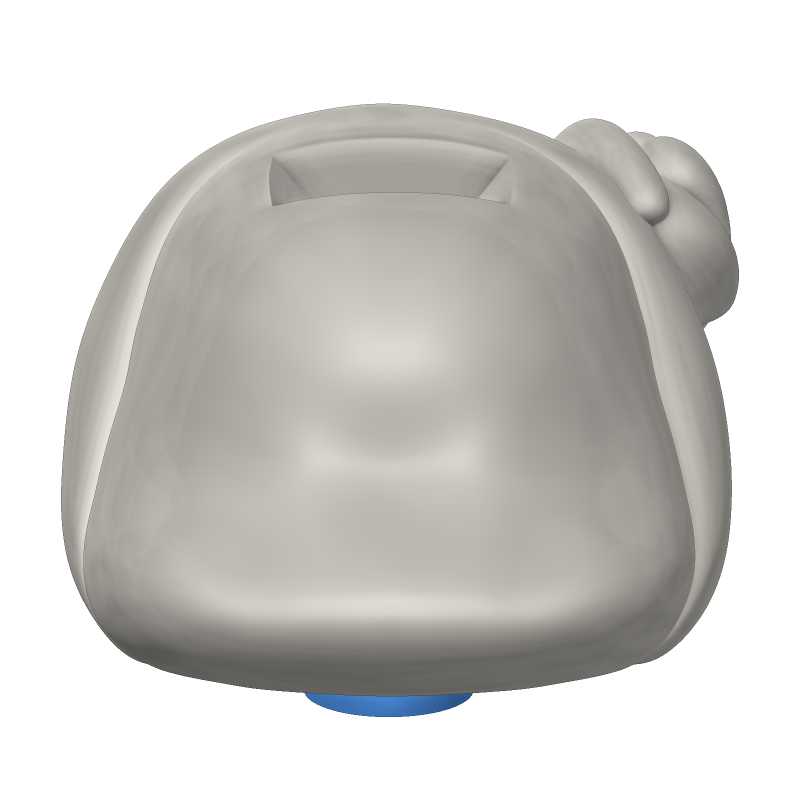 |
| Back | 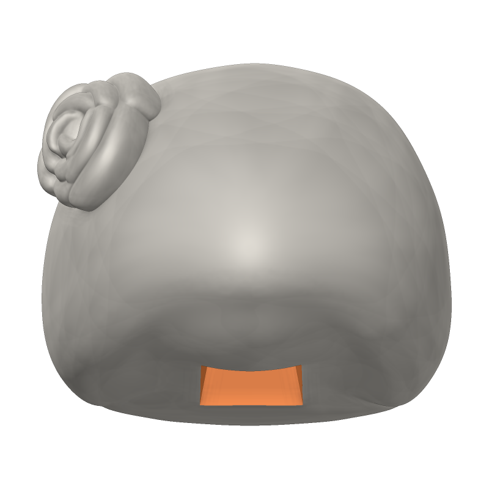 | 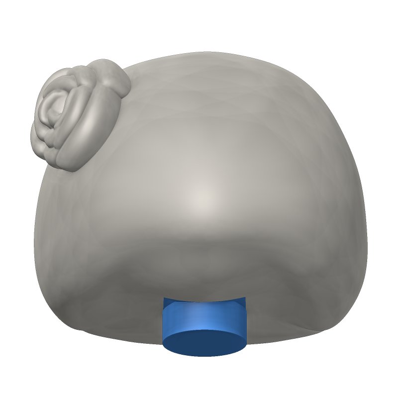 |
| Left | 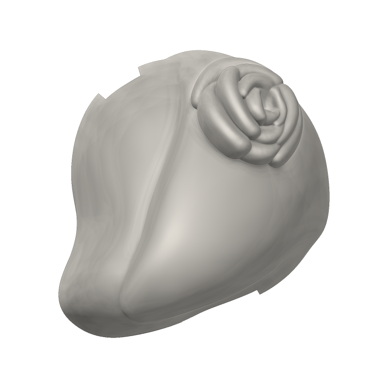 | 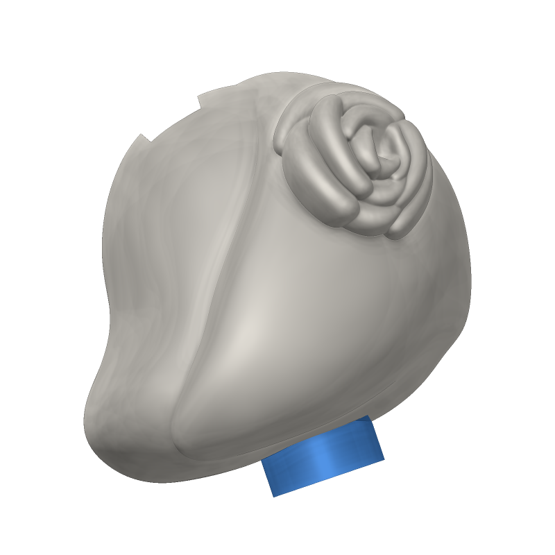 |
| Right | 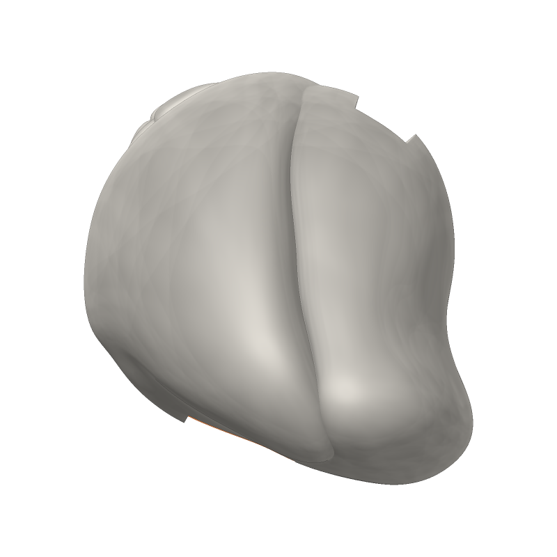 | 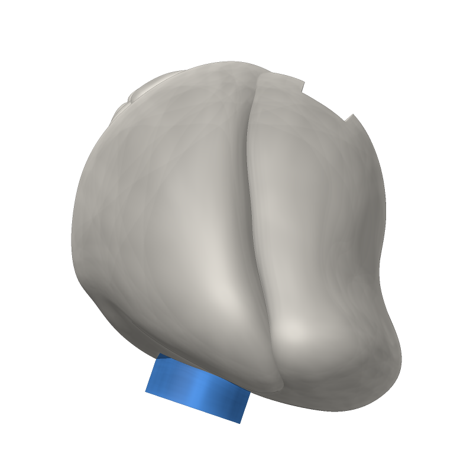 |
| Top |  | 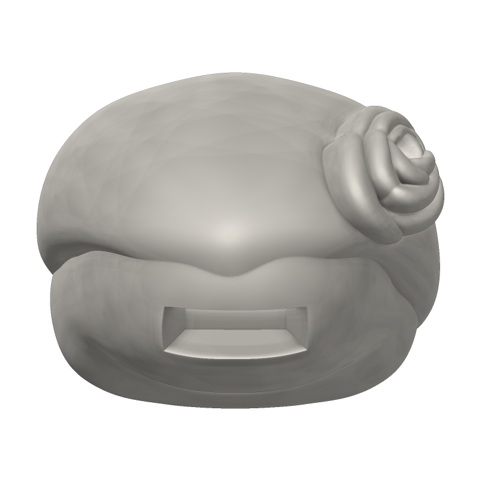 |
| Bottom | 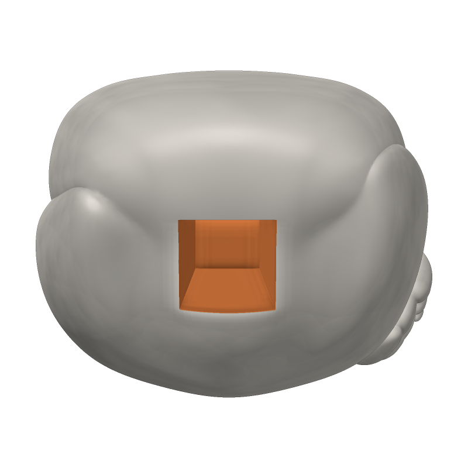 | 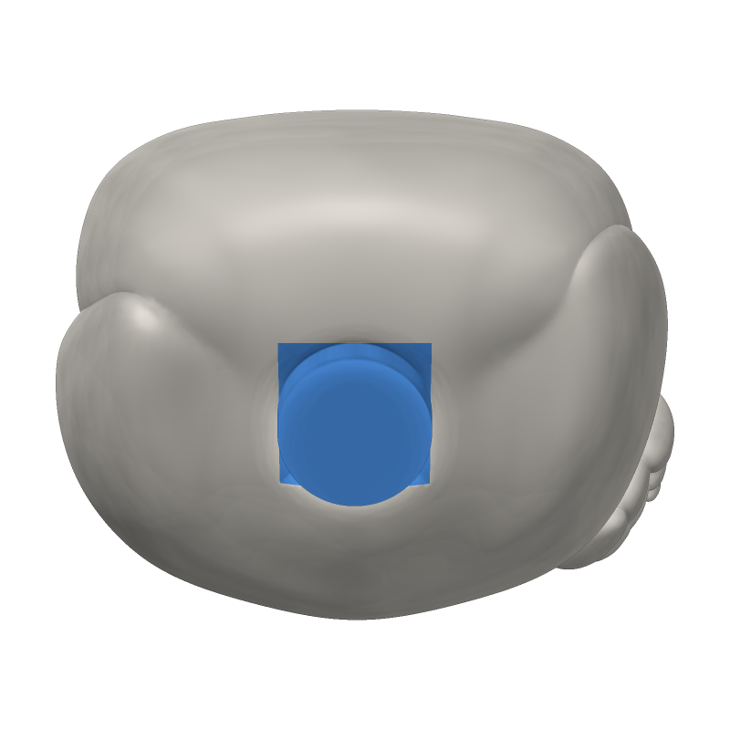 |
| Three-quarter | 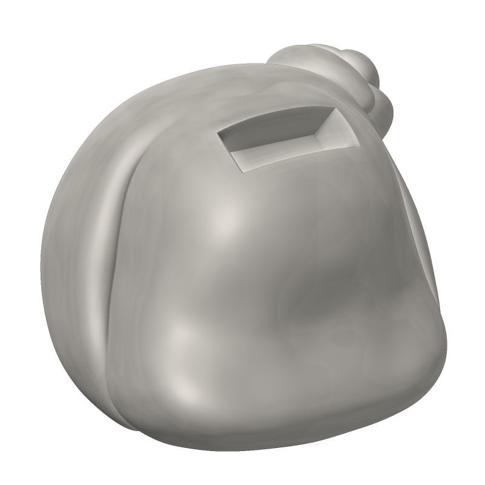 |  |
| Three-quarter, from below |  |  |

</details>
